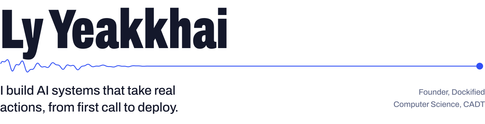
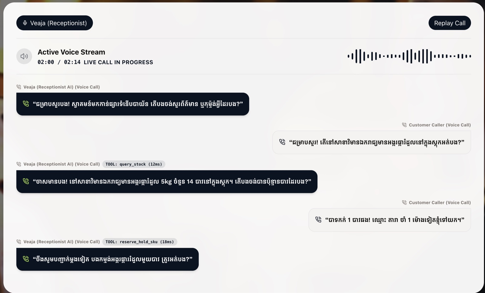
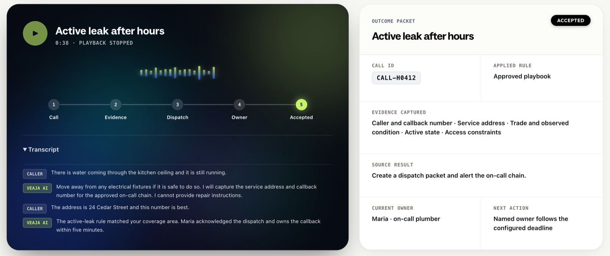
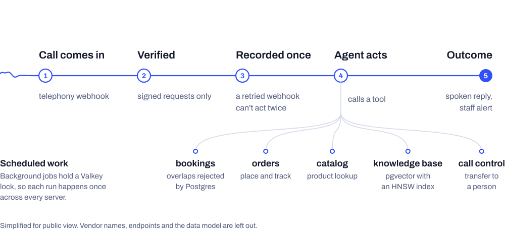
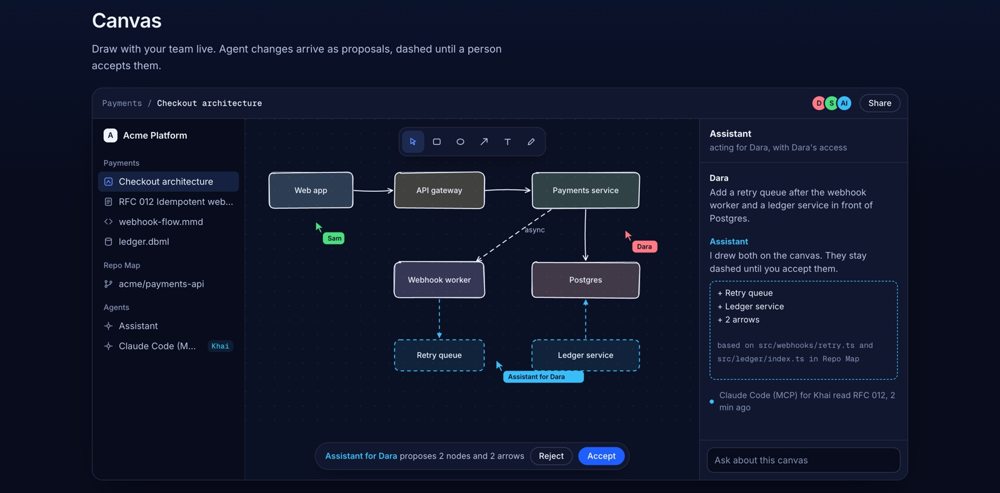
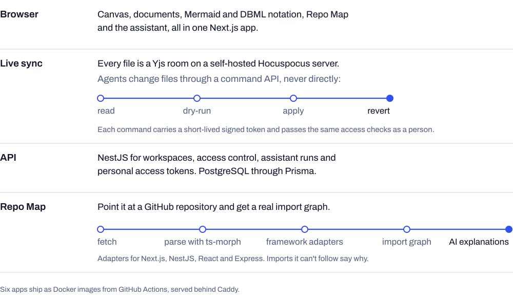
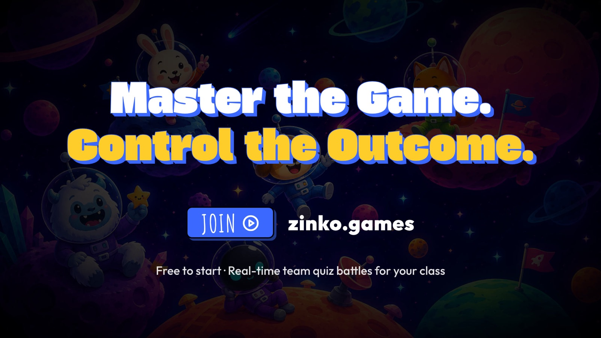
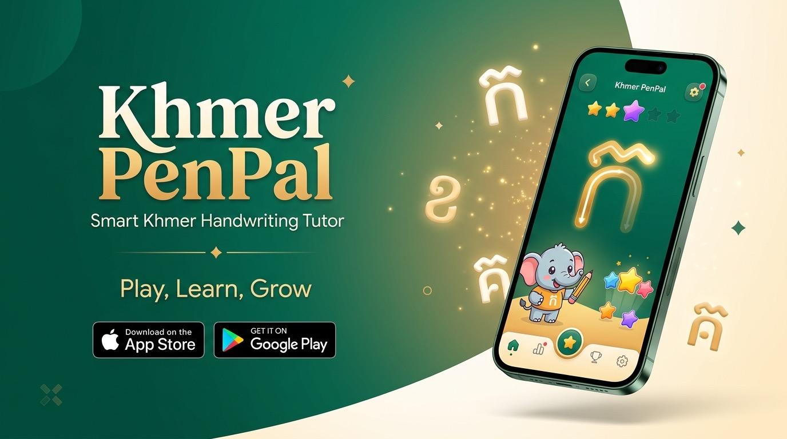

<picture>
  <source media="(prefers-color-scheme: dark)" srcset="assets/banner-dark.svg">
  
</picture>

 

I'm a software engineer and the founder of Dockified, and a third-year Computer Science student (Data Science) at the Cambodia Academy of Digital Technology.

I start from an operator's problem, like a local business missing calls or a team whose architecture docs drift from the code, and carry it through to running software: LLM agents that call tools against real data, the webhooks and transactions that keep them correct, and the servers they run on.

I'm looking for forward-deployed, AI engineering and full-stack AI systems roles.

 

## Veaja

**An AI voice agent that picks up a business's phone and gets the job done.** It talks with callers in real time in Khmer or English, checks stock, holds orders, books appointments and dispatches on-call staff while the caller is still on the line. Every call then ends as a clear record of what happened and who handles the next step. I lead the seven-person team and own the backend.

A live call in Khmer. The tags show the agent checking stock (<code>query_stock</code>) and holding the item (<code>reserve_hold_sku</code>) mid-conversation.

An after-hours leak call turns into a dispatch. The call ends as a record with the evidence captured, the on-call plumber who owns it and the next action.

<picture>
  <source media="(prefers-color-scheme: dark)" srcset="assets/architecture/veaja-dark.svg">
  
</picture>

- The voice pipeline runs speech-to-text, an LLM and text-to-speech in real time, with Khmer-specific voice routing.
- The agent works through a registry of typed tools for bookings, orders, catalog lookups, knowledge retrieval and call transfer.
- Business documents (PDF, DOCX and FAQs) are embedded into pgvector with an HNSW index for retrieval.
- Every webhook event lands in an inbox keyed on call and event, so a provider retry can't place the same order twice.
- Overlapping bookings are rejected by a Postgres exclusion constraint, not by application code that has to remember to check.
- Background jobs take a Valkey lock, so each scheduled run happens once across every server.
- NestJS and Prisma, tested with Vitest. Every push is built and tested in CI, and `main` deploys as a Docker image through Coolify.

[veaja.dockified.com](https://veaja.dockified.com) · private codebase

 

## LiveFlows

**A system design workspace where people and AI agents edit the same diagrams and docs.** It holds a live canvas, design documents, Mermaid and DBML, and a dependency map parsed from a real repository. An agent's change shows up as a proposal tied to the person it acted for, and nothing changes until someone accepts it. I designed and built it end to end.

<picture>
  <source media="(prefers-color-scheme: dark)" srcset="assets/architecture/liveflows-dark.svg">
  
</picture>

- Real-time editing runs on a self-hosted Hocuspocus and Yjs server, with one room per file, live presence and Postgres persistence.
- Agents never write to a document directly. They read, dry-run, apply and revert through a command API, each request carrying a short-lived signed token.
- Repo Map fetches a GitHub repository, parses it with ts-morph and builds an import graph. Imports it can't resolve say why, and an LLM explains any file or folder on request.
- The in-app assistant runs with toolsets scoped to the canvas, documents, Repo Map and workspace, and the user picks the model.
- Six apps in one monorepo, tested with Vitest and Playwright, each shipped as its own Docker image.

[liveflows.dev](https://liveflows.dev) · private codebase

 

## Also shipped

<table>
<tr>
<td width="50%" valign="top">

**[Zinko](https://zinko.games)** is a real-time team quiz game for classrooms, with game PINs, power-ups and live scoring. More than 200 students have played it.

I took it to production: Docker and Coolify deployment, CI, security fixes (headers, patched dependencies, closed ports, secrets out of the source) and caching that removed loading screens on reload.

</td>
<td width="50%" valign="top">

**[Khmer PenPal](https://khmerpenpal.com)** is an AI tutor that teaches children to write Khmer script, with a bilingual English and Khmer site.

I built the content API in Express and SQLite with CI that deploys on merge, worked on the frontend, and collected and cleaned Khmer handwriting data for model training.

</td>
</tr>
</table>

 

## How I work

**I start with the operator.** Veaja began as customer-discovery interviews, before any code.

**I make correctness structural.** Idempotency keys, database constraints and locks mean a retry or a race fails safely, even when someone forgets a check.

**I own it in production.** Linux servers, Docker, Coolify, Caddy, DNS, HTTPS and CI/CD, and I keep watching after it ships.

**I build with coding agents, and review what they write.** Specs, tests and code review are what make that speed safe to ship.

 

## Tools I use

| Area | Tools |
| --- | --- |
| AI systems | LLM tool calling, RAG with pgvector, voice agents, agent protocols and MCP, Vercel AI SDK |
| Backend | TypeScript, Node.js, NestJS, Express, Python, Socket.IO |
| Data | PostgreSQL, Prisma, Redis and Valkey, Supabase, SQLite |
| Frontend | React, Next.js, Tailwind, Yjs |
| Infrastructure | Docker, Coolify, Caddy, Linux, GitHub Actions |

 

## Public code

Most of my product work is in private organization repositories. These two are public:

- **[AGI-trading](https://github.com/lyyeakkhai/AGI-trading)**: a single-user AI trading research and execution platform in Python and TypeScript.
- **[CADT-Events](https://github.com/lyyeakkhai/CADT-Events)**: a campus event platform where students find events and register in one click ([live](https://cadt-events.vercel.app)).

 

Reach me on [LinkedIn](https://www.linkedin.com/in/ly-yeakkhai-3aaa89406).

 

<picture>
  <source media="(prefers-color-scheme: dark)" srcset="https://raw.githubusercontent.com/lyyeakkhai/lyyeakkhai/output/github-snake-dark.svg">
  
</picture>
